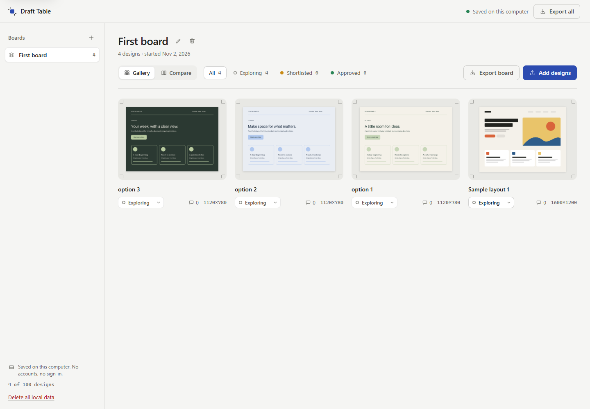
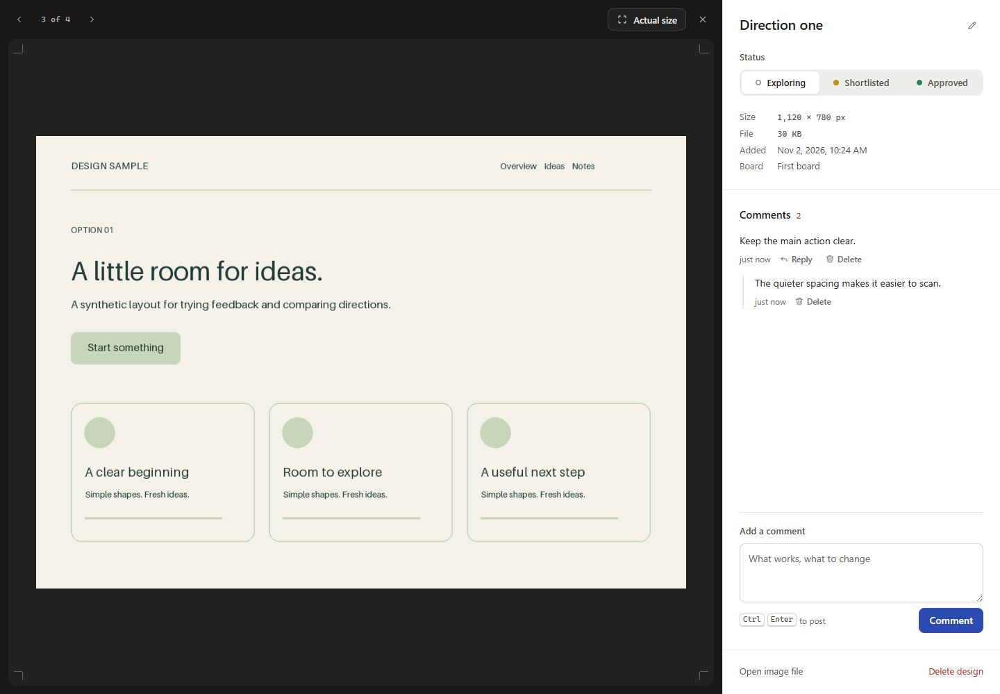

# Draft Table

A small, local place to compare design images and keep feedback beside the work.

Drop in a few screenshots, shortlist a direction, and leave comments or replies. Everything is saved on your computer. No accounts, subscriptions, API keys or external services.





## Run

Install Python 3.11 or newer, download this repository, open a terminal in its folder, and run:

```sh
python -m design_review
```

Open **http://127.0.0.1:18741** and keep the terminal open. On Windows, `py -m design_review` also works. Stop with Ctrl+C. There are no packages to install.

Try uploading the three synthetic images in [`examples/`](examples/). They contain no client work or real data.

## A useful review loop

1. Create a board for the question you are working through.
2. Upload PNG or JPEG directions and give them clear names.
3. Open a design to add feedback and replies.
4. Mark designs as exploring, shortlisted or approved.
5. Export a ZIP containing the original images and a readable `review.json` when you want a copy outside the app.

Deleting a design removes its image and feedback from this workspace. Deleting a board removes its designs. Reset clears the workspace after confirmation. These actions do not touch the original files you uploaded from elsewhere.

## Where the data goes

The app stores images, boards and feedback together in `data/reviews.sqlite3`. That folder is excluded from Git. Stop the app before copying the database as a backup. Exports contain your uploaded images and comments; choose where you share them.

An optional storage folder or port can be supplied without changing global settings:

```sh
python -m design_review --port 18742 --data-dir ./another-workspace
```

The starter is intentionally for one person, or people taking turns on one trusted computer. It does not provide accounts, public links, real-time collaboration or authentication. Keep it on the printed loopback address; do not place it behind a public proxy or expose it to a network.

## Limits

- PNG and JPEG only, up to 8 MiB per image, 8192 pixels per side and 16 megapixels.
- Standard non-interlaced PNG, up to 8 bits per channel; standard or progressive JPEG. Animated images, SVG, HTML and video are not accepted.
- 20 boards, 100 designs, 1,000 feedback messages and 64 MiB of image data per workspace.
- Exports preserve the originals, including any metadata they contain. Export is available; import is not implemented.
- Deleting data is not a secure disk-erasure feature. Other software running as your computer user remains inside the trust boundary.

## Development

```sh
python -m unittest discover -s tests -v
```

The backend uses Python's standard library and SQLite. The interface is plain HTML, CSS and JavaScript with system fonts. Runtime dependencies: none. See [SECURITY.md](SECURITY.md), [PROVENANCE.md](PROVENANCE.md), [design notes](docs/design-notes.md) and the [changelog](CHANGELOG.md).

Codex implemented the backend and tests. Claude Code led the interface and used its installed design guidance. The repository records that collaboration directly; it does not claim user adoption or comparative performance that has not been measured.

MIT licensed. Maintained under the public handle Jgolding1998.
